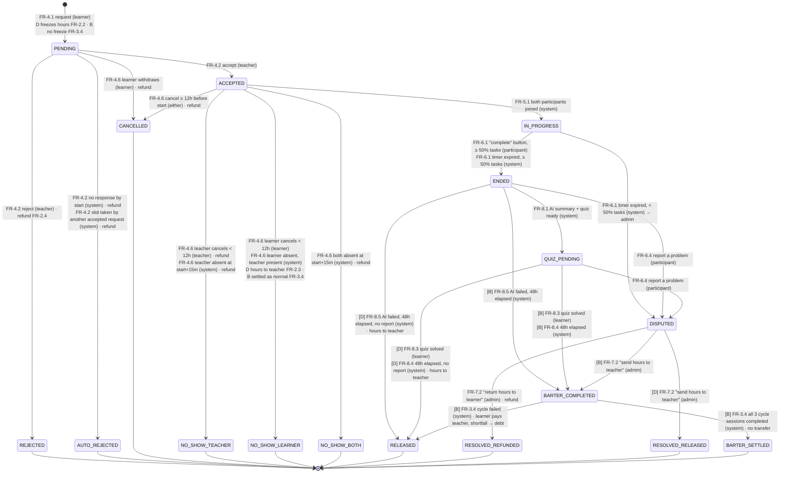

# Session state machine

Source of truth in code: [`src/server/domain/session-state-machine.ts`](../src/server/domain/session-state-machine.ts).
A unit test checks that every transition in the code appears in the diagram below as `FROM --> TO`, so the two cannot drift apart.

Enum: `SessionStatus` in [`prisma/schema.prisma`](../prisma/schema.prisma). Every change of status:

1. runs inside a DB transaction,
2. uses compare-and-set (`UPDATE … WHERE id = ? AND status = <from>`; 0 rows updated → someone else won the race → abort),
3. appends a `SessionEvent` row (`trigger` = the label below, e.g. `FR-4.2:accept`),
4. performs its wallet effect (if any) through `postLedgerEntries` in the same transaction.

## Diagram

Edge labels give the trigger (FR ID) and the actor in brackets. `[D]` means DIRECT sessions only and `[B]` means BARTER only. Unmarked edges apply to both kinds.

## Transition table

| From | To | Trigger | Actor | Kinds | Wallet effect |
|---|---|---|---|---|---|
| (new) | PENDING | `FR-4.1:request` | learner | D, B | D: freeze `duration` (FR-2.2); B: none |
| PENDING | ACCEPTED | `FR-4.2:accept` | teacher | D, B | none |
| PENDING | REJECTED | `FR-4.2:reject` | teacher | D, B | refund escrow (FR-2.4) |
| PENDING | AUTO_REJECTED | `FR-4.2:no-response` | system (NFR-3) | D, B | refund escrow |
| PENDING | AUTO_REJECTED | `FR-4.2:slot-taken` | system | D, B | refund escrow (see Q-12) |
| PENDING | CANCELLED | `FR-4.6:learner-withdraw` | learner | D, B | refund escrow |
| ACCEPTED | CANCELLED | `FR-4.6:cancel-in-time` | either | D, B | refund escrow |
| ACCEPTED | NO_SHOW_TEACHER | `FR-4.6:teacher-late-cancel` | teacher | D, B | refund escrow |
| ACCEPTED | NO_SHOW_LEARNER | `FR-4.6:learner-late-cancel` | learner | D, B | D: release to teacher; B: barter settle (Q-17) |
| ACCEPTED | IN_PROGRESS | `FR-5.1:both-joined` | system | D, B | none |
| ACCEPTED | NO_SHOW_TEACHER | `FR-4.6:teacher-absent` | system (NFR-3) | D, B | refund escrow |
| ACCEPTED | NO_SHOW_LEARNER | `FR-4.6:learner-absent` | system (NFR-3) | D, B | D: release to teacher; B: barter settle |
| ACCEPTED | NO_SHOW_BOTH | `FR-4.6:both-absent` | system (NFR-3) | D, B | refund escrow (Q-9) |
| IN_PROGRESS | ENDED | `FR-6.1:complete-button` | participant | D, B | none (sets `releaseDueAt = endedAt + 48h`) |
| IN_PROGRESS | ENDED | `FR-6.1:timer-expired` | system | D, B | none |
| IN_PROGRESS | DISPUTED | `FR-6.1:low-completion` | system | D, B | none: frozen hours stay frozen |
| ENDED | QUIZ_PENDING | `FR-8.1:quiz-ready` | system | D, B | none |
| ENDED | RELEASED | `FR-8.5:window-elapsed` | system | D | release to teacher (FR-2.3) |
| ENDED | BARTER_COMPLETED | `FR-8.5:window-elapsed` | system | B | hold |
| ENDED | DISPUTED | `FR-6.4:report` | participant | D, B | none: transfer stopped |
| QUIZ_PENDING | RELEASED | `FR-8.3:quiz-solved` / `FR-8.4:quiz-timeout` | learner / system | D | release to teacher |
| QUIZ_PENDING | BARTER_COMPLETED | `FR-8.3:quiz-solved` / `FR-8.4:quiz-timeout` | learner / system | B | hold |
| QUIZ_PENDING | DISPUTED | `FR-6.4:report` | participant | D, B | none |
| DISPUTED | RESOLVED_REFUNDED | `FR-7.2:refund-learner` | admin | D, B | refund escrow |
| DISPUTED | RESOLVED_RELEASED | `FR-7.2:pay-teacher` | admin | D | release to teacher |
| DISPUTED | BARTER_COMPLETED | `FR-7.2:pay-teacher` | admin | B | hold |
| BARTER_COMPLETED | BARTER_SETTLED | `FR-3.4:cycle-completed` | system | B | none (equal exchange) |
| BARTER_COMPLETED | RELEASED | `FR-3.4:cycle-failed` | system | B | learner available → teacher; shortfall → `Debt` |

**Terminal states:** REJECTED, AUTO_REJECTED, CANCELLED, NO_SHOW_TEACHER, NO_SHOW_LEARNER, NO_SHOW_BOTH, RELEASED, RESOLVED_REFUNDED, RESOLVED_RELEASED, BARTER_SETTLED.

**Calendar-blocking states** (DB exclusion constraint, no overlapping sessions per teacher and per learner): ACCEPTED, IN_PROGRESS.

## Notes

- **The 48h timer does not run while DISPUTED.** Frozen hours stay frozen until the admin decides (see Q-6 in [QUESTIONS.md](QUESTIONS.md)).
- **"Release to teacher"** credits the teacher's debt first if they have any (FR-3.4: debt is taken from the first hours earned).
- **Barter cycle status** (`BarterCycle.status`) is separate: PROPOSED → ACTIVE (all accepted) → COMPLETED or FAILED; PROPOSED → DECLINED or EXPIRED. Barter sessions are created only after the cycle is ACTIVE.
- **When a cycle fails**, sessions already BARTER_COMPLETED are settled at once. Sessions still running continue, and each is settled as soon as it reaches BARTER_COMPLETED.
- **A barter learner no-show** (NO_SHOW_LEARNER) is settled as a normal session (learner pays the teacher, shortfall becomes debt) but keeps its NO_SHOW_LEARNER status, and the cycle becomes FAILED (Q-17).
- **System transitions** run in `runScheduledJobs()` ([src/server/jobs/run-scheduled-jobs.ts](../src/server/jobs/run-scheduled-jobs.ts)) every minute: auto-reject, no-show, timer, 48h release, and barter cycle upkeep (NFR-3).
- **Attendance** counts only for room entries inside [start − 15 min, start + 15 min] (Q-8). Opening the room earlier is allowed but does not start the session.
